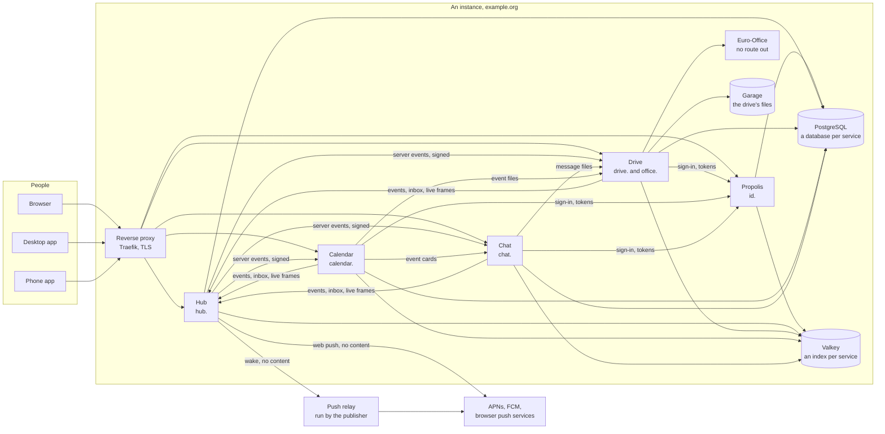

# Architecture

Ruchoir is a self-hosted collaboration suite, built in Europe: a chat, a drive for files and office
documents, and a calendar, with one identity service. Each part lives in its own repository and runs
as its own service. An **instance** is the set of services an organisation installs on its own
server, under its own domain (`example.org` below), with the installer.

This page is the map. The reasons are in the decisions (`docs/adr/` here, and in each repository),
and how to run the pieces is in [getting started](getting-started.md).

## The repositories

| Repository | What it is | On an instance | Licence |
|---|---|---|---|
| [`propolis`](https://github.com/Ruchoir/propolis) | Identity and organisations: accounts, sign-in, second factors, passkeys, the OpenID Connect provider, organisations, their members, groups and roles | `id.example.org` | `AGPL-3.0-only` |
| [`hub`](https://github.com/Ruchoir/hub) | Notifications and real time: the inbox, web and phone push, mail digests, live delivery to pages and apps, server events between services, the instance's manifest; and the push relay the publisher runs | `hub.example.org` | `AGPL-3.0-only` |
| [`drive`](https://github.com/Ruchoir/drive) | Files and folders, shares, versions, and live office editing with Euro-Office | `drive.example.org`, `office.example.org` | `AGPL-3.0-only` |
| [`calendar`](https://github.com/Ruchoir/calendar) | Personal and organisation calendars, recurring events, invitations, reminders, iCal subscriptions | `calendar.example.org` | `AGPL-3.0-only` |
| [`chat`](https://github.com/Ruchoir/chat) | Channels and direct conversations, threads, mentions, reactions, files, link previews | `chat.example.org` | `AGPL-3.0-only` |
| [`desktop`](https://github.com/Ruchoir/desktop) | The desktop app (Tauri), for Windows, macOS and Linux | installed on a computer | `AGPL-3.0-only` |
| [`mobile`](https://github.com/Ruchoir/mobile) | The phone app (Expo), for iOS and Android | installed on a phone | `AGPL-3.0-only` |
| [`installer`](https://github.com/Ruchoir/installer) | `ruchoir-install`: sets up and runs an instance à la carte, in production or for development | run by an administrator | `AGPL-3.0-only` |
| [`core`](https://github.com/Ruchoir/core) | The shared Rust crates and TypeScript packages, released as one version | built into the others | `MPL-2.0` |
| [`.github`](https://github.com/Ruchoir/.github) | The common rules, the decisions that span repositories, the shared CI | none | `MIT OR Apache-2.0` |

Propolis and the hub are part of every instance. The products (drive, calendar, chat) are chosen at
install time; the chat always brings the drive, which keeps the files of its messages.

## An instance

Every service is a Rust program with its own PostgreSQL database and Valkey index, behind one
reverse proxy that holds the certificates. A product with pages (Propolis, the drive, the calendar,
the chat) serves them itself, as a static export of a Next.js application. The installer writes the
whole instance as a directory (secrets, keys, the proxy's configuration, the clients Propolis knows,
the hub's subscriptions, a Compose file) and runs it with Docker Compose.

## How a client finds what is installed

1. An app or a page starts at `https://hub.example.org/.well-known/ruchoir-manifest`: the manifest
   the installer writes and the hub serves, listing each installed service with its address
   ([ADR 0004](adr/0004-installer-and-product-manifest.md)).
2. Each service then describes itself at `/.well-known/ruchoir-product`: its name, version and
   features. A client checks a feature, never a version number
   ([ADR 0005](adr/0005-api-contracts-and-versioning.md)).
3. Propolis's address comes from the manifest and its OpenID Connect discovery document; nothing
   assumes the `id.` prefix ([ADR 0012](adr/0012-propolis-host.md)).

An integration between products shows only when the other product is installed.

## Identity and calls between services

- **People sign in with Propolis**, the instance's OpenID Connect provider. Each product is a client
  of Propolis and keeps its own session for its pages (a backend-for-frontend). The apps are public
  clients (PKCE) and hold a token for the hub and for each product
  ([ADR 0001](adr/0001-propolis-identity-and-organisations.md)).
- **Services call each other with Propolis's tokens, never a shared secret.** On behalf of a person,
  by token exchange (RFC 8693), so the service called applies that person's rights; on their own
  behalf, with `client_credentials` and narrow scopes
  ([ADR 0006](adr/0006-service-to-service-authentication.md)).
- **Organisations live in Propolis; what a role may do lives in each product.** Propolis holds an
  organisation, its members, groups and roles; each product copies what it needs and decides what a
  role may do in it ([ADR 0017](adr/0017-a-roles-permissions-live-in-each-product.md)).

## Events and real time

- **Server events** use the `ruchoir-events` format, each signed by the service that emits it with
  its own Ed25519 key, whose public half Propolis publishes
  ([ADR 0011](adr/0011-server-events-and-security-events.md)).
- **Every server event goes through the hub**, which delivers it, unchanged, to the services
  subscribed to its kind, at least once, with retries
  ([ADR 0015](adr/0015-server-events-travel-through-the-hub.md)).
- **The hub never decides who may see what.** A product computes the audience of what it publishes;
  the hub keeps the inboxes and delivers
  ([ADR 0003](adr/0003-hub-notifications-and-real-time.md)).
- **A page opens the hub's socket with a single-use ticket** its product asks for; an app opens it
  with its own token, one socket per instance
  ([ADR 0016](adr/0016-a-ticket-to-open-the-hub-socket.md)).
- **Phones and browsers are woken without content.** The hub asks the push relay, run by the
  publisher of the apps, to wake a phone through Apple or Google, or wakes a browser through its
  vendor's push service; the device then asks its instance what to show.

## Boundaries

- **Each product owns its data.** A reference to another product's object is an opaque identifier,
  with no constraint across databases; what a cascade did becomes an event
  ([ADR 0002](adr/0002-product-boundaries-and-standalone-repositories.md)).
- **No repository imports another product's code.** It uses that product's public API or events,
  and shares code only through a released version of `core`.
- **Every repository stands alone**: it builds, tests and starts without another one checked out;
  the other services are replaced by test doubles built from their contracts.
- **Contracts only grow inside a major version.** Each service commits its OpenAPI contract
  (`contract/openapi-v1.json`), generated from the code, and a test refuses a removal, a rename or a
  retype. How every API looks: the [API style guide](api-style-guide.md).

## Shared code

`core` is released as one version (`vX.Y.Z`) for all its crates and packages
([ADR 0013](adr/0013-one-version-for-core.md)). The services read the crates from its tag with
Cargo (`git` and `tag`); the fronts install the npm packages (`@ruchoir/...`) from GitHub Packages,
which needs a `read:packages` token even for a public package. A product pins one version of `core`
for everything it uses.

## Where the decisions are

- Decisions that touch several repositories: [`docs/adr/`](adr/README.md) of this repository.
- Decisions of one repository: its own `docs/adr/`.
- How to work in a repository, its settings and its gotchas: its `AGENTS.md`, which opens with the
  [common rules](../common-rules.md).
